# netty-transport-nethernet

A NetherNet transport for Netty: Bedrock's WebRTC data channel transport, with a
server endpoint that takes joins from HTTP, Xbox RPC and LAN signaling (and from
NXS through the [`nethernet-nxs`](../nethernet-nxs/README.md) module), and a
client channel. In NetworkM this module targets Java 25 and runs on libwebrtc
through the [slim webrtc-java fork](https://github.com/EduGeyser/webrtc-java),
with Maven coordinates `io.github.sendablemetatype.webrtc:webrtc-java` and Java
packages under `io.github.sendablemetatype.webrtc`. Consumers also need matching
platform native libraries.

The module logs through SLF4J 2.0: the identity checks (through jose4j) and
libwebrtc's native log both write to it. Applications that use SLF4J logging must
provide a backend compatible with the 2.0 API. NetworkM leaves backend selection
to the application; its tests use the SLF4J bridge to Java logging.

What real retail and Education clients send and expect, and how vanilla BDS
answers, is recorded per version in [docs/client-behavior.md](docs/client-behavior.md).
Several choices below rest on it.

## Usage

> [!IMPORTANT]
> This library requires the platform-specific WebRTC native libraries at runtime. See the [WebRTC usage guide](https://github.com/EduGeyser/webrtc-java#usage) for instructions on how to include the native libraries in your project.

### Engine

Channels never touch libwebrtc directly. They run on a `NetherNetEngine`
(package `engine`), which creates peers and the shared ICE port. The default
engine is `WebRtcEngine` (package `engine.webrtc`), built with
`WebRtcEngine.builder()`:

| Builder method | Default | What it sets |
| --- | --- | --- |
| `factories(int)` | 1 | How many webrtc-java factories the engine pools. Each has its own network, signaling and control threads; peers go to them in turn. |
| `portAllocatorFlags(int)` | `DEFAULT_PORT_ALLOCATOR_FLAGS` | The `PortAllocatorConfig.PORTALLOCATOR_*` flags of every peer. TCP stays disabled. |
| `fieldTrials(Map)` | none | WebRTC field trials for every factory. |
| `nativeLogThreshold(Severity)` | `WARNING` | The lowest native severity that reaches SLF4J, see [Native log](#native-log). |

No native resources exist until the first peer or endpoint needs them.

An engine has exactly one owner, which closes it. Every channel constructor and
every `NetherNetChannelFactory` method makes the ownership explicit:

- no engine argument: the channel creates the default engine when it binds (or,
  for a client, at its first attempt) and closes it with itself;
- a `NetherNetEngine`: the channel uses it and never closes it, so one engine can
  serve several channels; its owner closes it after the last one;
- a `Supplier<? extends NetherNetEngine>`: the channel creates its own engine
  from the supplier and closes it with itself.

The `engine` package is the whole boundary: no webrtc-java type appears in the
channel, signaling or option APIs, and engine tuning lives only on the engine's
builder. Another engine implements `NetherNetEngine`, `Peer`, `DataLink` and
`IceEndpoint`; the package documentation states the threading, ordering and
teardown contract it must keep.

### Server endpoint

`NetherNetServerChannel` is one NetherNet endpoint. It takes joins from any number
of join sources, admits each through one admission stage, and emits a
`NetherNetChildChannel` per admitted join, like any Netty server channel.

```java
ServerIdentity identity = ServerIdentity.loadOrCreate(Path.of("nethernet-identity.pem"), "My server");

Channel endpoint = new ServerBootstrap()
        .group(bossGroup, workerGroup)
        .channelFactory(NetherNetChannelFactory.server())
        .option(NetherChannelOption.NETHER_SERVER_IDENTITY, identity)
        .childHandler(new MyInitializer())
        .bind(new InetSocketAddress(19133))
        .sync().channel();

NetherNetHttpSignaling http = NetherNetHttpSignaling.builder(workerGroup).build();
http.bind(new InetSocketAddress(19132)); // TCP; not from the worker group's loops
((NetherNetServerChannel) endpoint).addSource(http);
```

**Identity.** `NETHER_SERVER_IDENTITY` is required; binding fails without one.
One `ServerIdentity` signs the answers of every source. Plain HTTP clients pin
its key and ask the player once to trust it, so a new key prompts every
returning player again
([client behavior](docs/client-behavior.md#what-the-client-requires-of-the-answer)).
Choose one explicitly:

- `ServerIdentity.loadOrCreate(keyFile, domain)` loads a PEM key (SEC1 or
  PKCS#8, with or without a `PUBLIC KEY` block) or creates a secp384r1 key
  there. The file is created owner-only and never replaced once it exists.
- `ServerIdentity.ephemeral(domain)` keeps the key in memory only.

The endpoint logs the key's SHA-256 fingerprint when it binds;
`identity.fingerprint()` returns it for publishing, and `identity.publicKey()`
the key a client pins (see [Client](#client)). Code that signs descriptions
itself uses `ServerIdentity.augmentAnswer` and `ClientIdentity.withAssertion`;
both throw `GeneralSecurityException` when the key cannot sign, and no jose4j
type appears in their signatures.

**Sources.** `addSource(source)` and `addSource(source, policy)` add a join
source before or after bind. A source starts once the endpoint is bound and its
ICE port is open. `removeSource(source)` stops and closes one; joins it delivered
that have no child yet are refused. Neither touches connected players, since
every join replies through its own `ReplyPath`. A source starts once: to restart
one, remove it and add a new instance. Closing the endpoint closes its sources.
`sources()` lists them.

**Close.** The close future completes before the endpoint has let go of
everything: peers, the ICE port and an owned engine close afterwards on the
engine's threads. `termination()` completes once the children and the peers
sources opened have terminated, the sources have let go of their ports
(`JoinSource.termination()`: HTTP signaling's TCP listener, LAN discovery's UDP
socket), sources removed before the close included, the ICE port is closed, and an owned engine is closed. A host that binds
the same address again, as on a reload, waits for it, with a timeout: a part
whose teardown never finishes keeps it pending.

A custom source implements `JoinSource` and hands the endpoint a `Join` per offer
through the `JoinSink` it gets at start. Its `ReplyPath` carries the answer and
the refusal back; a path that settles joins on its own, as HTTP signaling does at
its deadline, fails a later refusal with `JoinAlreadySettledException`, and the
endpoint then does not count that refusal. `JoinSource.oneJoinPerNetworkId()`
(false by default, true for HTTP signaling) puts the source's joins under the
duplicate rule of [Admission](#admission). `JoinSink.sharedIcePort()` gives a
source the shared ICE port: `claimHeldChecks` takes the connectivity checks no
peer holds (NXS stateless joins), `monitorStun` keeps STUN bindings alive from
the port, and `openPeer` opens a peer that carries no player (NXS connectivity
checks). Such a peer gets no child channel and counts no session, but holds one
of the endpoint's pending joins until its termination completed; the source must
close it. Removing the source closes its peers.

**ICE port.** By default every peer gathers its host candidates on one UDP port,
the address and port the endpoint binds (`NETHER_SERVER_SHARED_ICE_PORT`, true).
Port 0 binds a free port, found when the endpoint binds. A taken port fails the
bind. The engine sets the port up after bind returned; a port it cannot set up
then closes the endpoint. Until then, joins are refused with `CAPACITY`.
`ready()` completes once the engine has set up the port and the
sources have started, and fails with the reason otherwise: the bind's failure,
why the port could not be set up (a `BindException` when another process took
it after the bind found it free), or a `ClosedChannelException` when the
endpoint closed first. It does not mean the port is held: the WebRTC engine
binds the UDP socket on each local address when the first peer gathers there, so
a process that takes the port in between costs the joins that gather while it
holds it their host candidates on that address, unreported.
Set
`NETHER_SERVER_SHARED_ICE_PORT` to false to give each session ports of its own
from `NETHER_CANDIDATE_POLICY`'s port window, the way BDS allocates them
([client behavior](docs/client-behavior.md#how-vanilla-bds-answers-for-comparison)).
The ICE port is UDP, so it can share a number with HTTP signaling on TCP, but
not with RakNet on UDP.

**Advertised addresses.** `NETHER_SERVER_ADVERTISED_ADDRESSES` lists addresses
answers announce. Read them from configuration with
`AdvertisedAddresses.parse(values, defaultPort)`: IP literals or host names, port
0 for the media port, at most `AdvertisedAddresses.MAX_ENDPOINTS` (32). Names
are looked up once, off the event loop, when the endpoint binds; until they
resolve, answers announce the literals only, and a name that does not resolve
closes the endpoint. An address the host gathered narrows the host candidates to
it; any other is announced as the public side of a NAT. Empty by default: answers
carry what ICE gathered plus the address in the client's `Host` header.
`NetherNetServerChannel.advertisedAddresses()` returns the list answers announce
at the moment, with the names resolved.

**STUN discovery.** Instead of advertised addresses, `NETHER_SERVER_STUN_SERVERS`
lists STUN servers (each with a port; `StunObserver.parseServer` reads `stun:`
URLs) that the shared ICE port asks for its public mapping every 15 s, which
also keeps the NAT mapping open. Answers announce each fresh mapping as a server
reflexive candidate, until `NETHER_SERVER_STUN_MAX_AGE` (5 minutes) after its
last answer or until a server reports another one. No join waits for the
servers. A mapping on another port than the ICE port is also announced on the
ICE port, for a router that forwards the ICE port but moves the port of outgoing
traffic. Binding fails when STUN servers are set together with advertised
addresses, with PROXY protocol relays, or without the shared ICE port.
`NetherNetServerChannel.discoveredAddresses()` returns the fresh mappings with
their ICE port twins, as answers announce them.

**Candidate options.**

| Option | Default | Meaning |
| --- | --- | --- |
| `NETHER_SERVER_INFER_PEER_CANDIDATES` | true | Checks guessed candidates at the address a client signaled from, when it offers only host candidates and this host gathered no public one. |
| `NETHER_ICE_SERVERS` | none | STUN and TURN servers every peer uses, next to those a source hands out (Xbox TURN). |
| `NETHER_CANDIDATE_POLICY` | `CandidatePolicy.DEFAULT` | IPv6, local addresses and the port window for gathering. |
| `NETHER_SERVER_STUN_SERVERS` | none | STUN servers that report the shared ICE port's public mapping, see above. |
| `NETHER_SERVER_STUN_MAX_AGE` | 5 minutes | How long a mapping is announced after its last answer; positive. |

**Remote candidates.** The server applies only UDP candidates with an IP
literal: at most 32 from the offer and 32 more trickled. A name would make the
server look it up for whoever sent the offer, and NetherNet gathers no TCP. It
drops candidates at a multicast, limited broadcast or unspecified address, since
no peer can answer a check from there; loopback and link-local addresses stay,
for peers on the same host or link. Behind PROXY protocol relays it applies no
remote candidate at all.

**Trusted proxies.** `NETHER_SERVER_TRUSTED_PROXIES` takes a `TrustedProxies`
(transport-common, `util.address`): one list of peers whose PROXY protocol
header is read, one of peers whose `X-Forwarded-For` is read. Parse each list
once at startup with `TrustedProxies.parseList`, off any I/O thread: entries are
addresses, CIDR ranges, host names or `https://` URLs listing more entries;
`http://` URLs are refused. An entry that cannot be read (not an address, a
CIDR range or a name that resolves, or a list that cannot be fetched or names
nothing) is logged and skipped, and the parsed `ProxyList` names it. On the
endpoint, the PROXY protocol list names the relays in front of the shared ICE
port: the port reads their PROXY protocol v2 headers, and players reach the
server only through a relay or TURN, so the origin's address never appears in
an answer. This needs the shared ICE port. A relay list that named entries none
of which could be read fails the bind with `UnreadableRelaysException`, since
the endpoint would otherwise take players directly; one with some readable
entries binds with those. To bind without relays on purpose, pass
`ProxyList.NONE` for the list, as `TrustedProxies.NONE` does.
HTTP signaling reads its own list (`NetherNetHttpSignaling.Builder.trustedProxies`);
pass it the same parsed value. With `NETHER_SERVER_PREFER_PROXIED_ADDRESS` (false
by default), a child keeps reporting the client address a trusted signaling proxy
declared instead of the selected ICE pair; a TURN pair is reported as the relay
either way.

Behind relays, set `NETHER_SERVER_ADVERTISED_ADDRESSES` to the relays' public
addresses: answers announce those and TURN relay candidates (without their
related address, which is this host's public mapping). Without advertised
addresses, answers carry only TURN relay candidates, and bind logs a warning.
The warning has two forms. With a TURN server in `NETHER_ICE_SERVERS`
(`IceServer.isTurn()`), players connect through TURN, not through the relays.
Without one, answers carry no candidates, players cannot reach the server
through the relays at all, and only joins whose signaling hands out TURN servers
(Xbox) can connect. Bind sees only the TURN servers the host configured, not
those Xbox hands out per join.

### Admission

Every join, whatever its source, passes the same stage on the endpoint's event
loop:

1. One pending join per network ID, for sources that ask for it
   (`JoinSource.oneJoinPerNetworkId()`, HTTP signaling): a second offer for a
   network ID whose join is still pending is refused with `DUPLICATE` before it
   gets a peer, and the first join is left alone. The rule spans every such
   source of the endpoint. A join holds its network ID until its answer is sent
   or it fails, also after its source was removed.
2. The per-address throttle (`NETHER_SERVER_THROTTLE`). The default
   `DefaultNetherServerThrottle` allows 100 open connections and 30 joins per
   4 s per address, IPv6 counted per /64; a school shares one NAT address. Joins
   from an unknown address (Xbox RPC) are not throttled.
3. One budget shared by all sources: `NETHER_SERVER_MAX_SESSIONS` (unlimited by
   default) and `NETHER_SERVER_MAX_PENDING_JOINS` (256), the joins that have not
   gone active yet.
4. The offer's identity check (`NETHER_SERVER_OFFER_CHECK`, `OfferCheck.minecraft()`
   by default), off the event loop on a bounded executor (up to four threads and
   64 queued checks), with a deadline (`NETHER_SERVER_OFFER_CHECK_TIMEOUT_MILLIS`,
   10,000). The endpoint fetches the trusted issuers' keys when it binds, so the
   first join does not wait for them.
5. The source's `OfferPolicy` decides on the check's result.
6. The host's join filter (`NETHER_SERVER_JOIN_FILTER`), if one is set.

An offer whose `a=max-message-size` the endpoint cannot use is refused as
`BAD_OFFER` before the check. A join whose source authenticated the client itself
(`Join.Authenticated`, NXS) skips the check and the policy; the throttle, the
budget and the join filter apply to it all the same.

A join holds its share of the budget and its throttle entry until its child's
`termination()` stage completed, not merely until the child closed. A child that
does not go active within `NETHER_SERVER_RTC_HANDSHAKE_TIMEOUT_SECONDS` (30) is
closed.

**Join filter.** A `NetherServerJoinFilter` is the host's say over who joins, for
example an allow list or a ban list. Its `allows(request)` sees a `Request`: the
join's source, the client's network ID, its address as the source saw it, the
`Host` header and the `ClientInfo` of an HTTP join (null on other sources;
`ClientInfo` is also null when the request carried no usable query), and the identity check's
result (null for an NXS join). Everything except the source and the check result
comes from the client unchecked. The filter runs on the identity check executor,
shares its threads and queue, and counts against the same deadline, which runs
from the start of the check. Keep it quick. False refuses the join with
`HOST_REFUSED`; an answer past the deadline refuses it with `NO_ANSWER_IN_TIME`,
and a filter that throws refuses it with `INTERNAL` (the first failure is logged
as a warning, later ones at debug).

**Identity check levels.** `OfferCheck` grades the offer's `a=identity` in three
steps and returns one `OfferCheckResult`:

| Level | Meaning |
| --- | --- |
| `NO_ASSERTION` | The offer has no `a=identity`. |
| `MALFORMED` | The assertion, its token or its key cannot be read. |
| `PROOF_FAILED` | The fingerprint signature does not verify under the token's `cpk`. |
| `KEY_PROVEN` | The client holds the token's key and signed this offer's fingerprints. The token is not attested; `reason()` says why. |
| `ATTESTED` | As `KEY_PROVEN`, and a trusted issuer signed the token. |

The `idp` block is not checked. Proving the key needs no network. Attesting
picks the `TrustedIssuer` by the token's exact `iss` before any key lookup, so a
forged token cannot make the server fetch anything. `OfferCheck.minecraft()`
attests retail tokens against Minecraft's authorization service. For other
issuers, build `new OfferCheck(issuers)` with `TrustedIssuer.jwks(...)` or
`TrustedIssuer.fixedKey(...)`.

**Policies.** `OfferPolicy.REQUIRE_KEY_PROVEN` is the default for every source:
it admits `KEY_PROVEN` and `ATTESTED`. Education clients send a self-signed
token that no issuer attests and pass on their proof
([client behavior](docs/client-behavior.md#the-clients-offer)).
`OfferPolicy.REQUIRE_ATTESTED` admits only `ATTESTED`, which refuses every
Education client and every join while the issuer's keys are unreachable. A
custom `OfferPolicy` returns an `IdentityRefusal` to refuse; it runs on the event
loop and must not block. Each refusal is logged at info level with the join's
connection ID, address and the check's diagnostics; logs never contain the token.

The admitted child carries the result in `child.getOfferCheck()` (attribute
`NetherNetChildChannel.OFFER_CHECK`). `xuid()` and `displayName()` read the `xid`
and `xname` claims; they are only as trustworthy as `attested()` says. The child
also carries `NetherNetChildChannel.CONNECTION_ID`, the client's connection ID,
and for a join over HTTP signaling `child.addressed()`, the request's
`Join.Addressed`: its `Host`, the local port, whether a trusted proxy sent it, and
whether its connection spoke TLS (`tls()`), which tells a join signaled over
HTTPS from one over plain HTTP.

**Refusals.** A refused join creates nothing. Its source tells the client with a
`JoinRefusal`: an HTTP status with an empty body over HTTP, a `CONNECTERROR`
signal with a NetherNet error code over Xbox RPC and LAN. NXS sends neither: a
refused stateless join's check is dropped, and a refused assisted join fails its
answer to the provider. What retail and Education clients show for each status
and code (captured 2026-11-07) is in
[docs/client-disconnect-reasons.md](docs/client-disconnect-reasons.md).

| `JoinRefusal` | HTTP | Error code | When |
| --- | --- | --- | --- |
| `IDENTITY_MISSING` | 401 | 16 | The policy refused an offer without an assertion. |
| `IDENTITY_INVALID` | 401 | 16 | Malformed assertion, failed proof, or not attested where the policy requires it. |
| `HOST_REFUSED` | 403 | 16 | The join filter refused the join. |
| `CAPACITY` | 503 | 16 | Throttle, budget, a full check executor, endpoint not ready or closing, or the source was removed. |
| `TRUST_SOURCE_UNREACHABLE` | 500 | 11 | Attestation was required and the issuer's keys could not be fetched. |
| `NO_ANSWER_IN_TIME` | 504 | 2 | The identity check, the join filter, or the answer missed its deadline. |
| `BAD_OFFER` | 400 | 13 | The offer is unusable: empty, for a network ID that does not decode, an SDP the identity check cannot read, an unusable `a=max-message-size`, or a description the engine refused. |
| `DUPLICATE` | 409 | 16 | Another offer for the same network ID is still pending (HTTP). |
| `INTERNAL` | 500 | 11 | A failure on the server while answering, or a join filter that threw. |

Error code 2 is NegotiationTimeout, 11 FailedToCreateAnswer, 13
FailedToSetRemoteDescription and 16 IncomingConnectionIgnored, positions in the
client's signaling error enumeration as go-nethernet lists it. Clients act on each
of them at once. GenericFailure (35) is not used: retail and Education ignore it
and wait for their own timeout.

### Login key binding

NetherNet runs over DTLS and skips the RakNet encryption handshake, so nothing
ties the Bedrock Login chain to the transport by itself. A Login captured from
another player could be replayed over a new connection. Every child carries a
`TransportIdentityBinding` in `TransportIdentityBinding.ATTRIBUTE`, bound to the
key the offer proved, or unbound when it proved none. Real clients sign the Login
with the offer's `cpk`, retail and Education alike
([client behavior](docs/client-behavior.md#the-clients-offer)).

Applications own Login authentication; NetworkM does not parse Login packets.
Once the chain is verified, decide it against the transport, once per Login:

```java
switch (TransportIdentityBinding.verifyLogin(channel, loginChainKey)) {
    case ACCEPTED -> { } // the login comes from the client that opened this transport
    case NOT_NETHERNET -> { } // not NetherNet: that transport's own authentication applies
    case MISMATCH, UNBOUND, SPENT -> channel.close();
}
```

The check finds the binding by attribute, so wrapper channels that delegate
attributes work. A binding is spent by its first decision. An application that
admits a login through its own trusted forwarding path calls
`TransportIdentityBinding.acceptForwardedIdentity(channel)` instead.
`TransportIdentityBinding.state(channel)` reports where a binding stands without
spending it.

### HTTP signaling

`NetherNetHttpSignaling` is the direct connection path of Mojang's onboarding
guide: the client asks `GET /v1/join` before anything else, then sends its offer
as `POST /v1/join/{networkId}` and gets the full answer back. Build it with
`NetherNetHttpSignaling.builder(workerGroup)`, where the group takes NIO channels
and is not owned. `bind(address)` returns once the listener listens; call it
outside the worker group's loops. Then add it to an endpoint. A closed instance
cannot be bound again.

| Builder method | Default | What it sets |
| --- | --- | --- |
| `tls(TlsContextSelector)` | none | TLS next to plain HTTP on the same port. |
| `requiresTls(boolean)` | false | Refuses plain HTTP with `426`, also while no certificate is available. |
| `trustedProxies(TrustedProxies)` | `NONE` | The proxies allowed to declare a client's address. |
| `statusProvider(StatusProvider)` | none | What `GET /v1/join` answers with. Without one, an empty `200`. |
| `statusTimeout(Duration)` | 1 s | How long a status request waits for the provider. |
| `negotiationTimeout(Duration)` | 15 s | How long an offer may wait for admission and its answer, from the end of its request. Past it, `504`. |
| `maxConnections(int)` | 1024 | Open signaling connections. |
| `maxConnectionsPerAddress(int)` | 100 | Open connections per client address (IPv6 per /64, proxied clients by their declared source). |
| `maxRequestBodyBytes(int)` | 32 KiB | The largest request body; larger ones get `413`. |
| `metrics(NetherServerMetrics)` | none | Where the source reports what it refuses on its own, see [Metrics and access log](#metrics-and-access-log). |
| `tlsHandshakeFailures(Consumer<TlsHandshakeFailure>)` | none | Told about every TLS handshake that started and failed, see below. |

**TLS.** Each connection's first bytes say whether it is TLS. On a TLS
ClientHello the `TlsContextSelector` is asked with the requested server name
(SNI), or null when the client sent none, as clients do for an IP address. It
returns the `SslContext` to serve, or null to withdraw TLS for that connection,
which closes it. Clients read that as TLS refused and go on with plain HTTP and
the trust prompt, whereas a certificate they reject may end the join
([client behavior](docs/client-behavior.md#what-the-client-requires-of-the-answer)).
Withdraw TLS rather than serve a certificate the client would reject, such as an
IP address certificate to a player who connected by domain name. A new
certificate applies from the next connection. `TlsContexts.fromPem(...)` and
`TlsContexts.fromPkcs12(...)` load contexts from files.

A handshake that starts and fails, most often because the client rejected the
certificate, goes to the `tlsHandshakeFailures` listener as a
`TlsHandshakeFailure`: the client's address (the one a trusted PROXY protocol
header declared, else the connection's peer), the server name it asked for, and
the cause (an `SSLException` for a TLS error, a `ClosedChannelException` when
the connection closed first). Withdrawn TLS starts no handshake and is not
reported. The listener runs on the I/O thread; anyone can fail handshakes at
will, so a listener that logs should limit itself.

```java
SslContext ipCertificate = TlsContexts.fromPem(chain, key, null);
NetherNetHttpSignaling http = NetherNetHttpSignaling.builder(workerGroup)
        .tls(serverName -> serverName == null ? ipCertificate : null)
        .statusProvider(request -> StatusAnswer.serve(currentStatus))
        .build();
```

With `requiresTls`, plain HTTP is always refused, which turns a client whose TLS
attempt failed into no NetherNet join at all.

**Status.** The `StatusProvider` answers each `GET /v1/join` with
`StatusAnswer.serve(status)` or `StatusAnswer.decline()` (`404`, which a client
that still has RakNet reads as "join over RakNet"). It runs off the I/O threads,
at most 64 calls at once. A call that throws, misses the status deadline or finds
no free slot gets the last document served for the same `Host`, or an empty
`200`, never an error. That fallback reaches whoever names the `Host`, so answer
a document chosen for one requester, such as a MOTD picked by address, with
`StatusAnswer.serveToRequester(status)`, which it never repeats. The endpoint
is open to anyone, so keep each call cheap, for example by serving a cached
`NetherNetServerStatus`. The `StatusRequest` carries the `Host` header, the
source address, the client's self-reported `ClientInfo` and the `id` query
parameter; all but the source come from the client unchecked. `GET` is also answered `404` whenever an offer would certainly
be refused: before `start`, after `close`, or when the endpoint is at capacity or
throttles the address.

`NetherNetServerStatus.builder()` builds the status document. Every member is
optional; unset members are omitted, and the seven vanilla sends reproduce its
response byte for byte. Use one nonce per endpoint for HTTP and LAN alike,
for example `NetherNetServerStatus.randomNonce()`.

**Connections.** A connection carries one request, or a status request and one
more request started within 5 s; each request has 10 s to arrive whole, and the
last response says `Connection: close`. A client that leaves while its offer is
pending abandons the join, and the endpoint closes the child unless it already
went active. An offer for a network ID that does not decode, or with an empty
body, is a `BAD_OFFER` (`400`). Other statuses besides the refusals: `400` for a
malformed request, `404` for other paths, `503` for an offer before `start` or
after `close`.

**Duplicate offers.** The endpoint takes one pending offer per network ID from
HTTP signaling, across all its HTTP sources: a second offer for a network ID
whose first offer has neither been answered nor failed gets `409`
(`DUPLICATE`), and the first goes on. The network ID is free again as soon as
the answer is sent, so a later offer for it is a new connect.

**Proxies.** A PROXY protocol header (v1 or v2) from a trusted PROXY protocol peer
wins over `X-Forwarded-For` from a trusted forwarder; nobody else can declare a
source. `X-Forwarded-For` is walked right to left without DNS. An entry without a
port keeps the forwarder's port.

#### Metrics and access log

Give the builder's `metrics` the same `NetherServerMetrics` the endpoint has as
`NETHER_SERVER_METRICS`. The endpoint reports the joins it admits and refuses;
HTTP signaling reports only what it refuses on its own, so nothing is counted
twice. A hook that throws is logged at debug and ignored.

| Event | When |
| --- | --- |
| `addressRefused(address)` | The address already holds as many signaling connections as it may. |
| `connectionCapRefused(address)` | Every signaling connection is taken, so a new one was closed unread. The address is the TCP peer, which is the proxy for a proxied client. |
| `requestTimedOut(address)` | A request did not arrive whole within 10 s, so its connection closed unanswered. The address is the client a PROXY protocol header declared, else the TCP peer. A connection that sends no second request after its status request is not reported. |
| `plaintextRefused(address)` | A plain HTTP request arrived under `requiresTls`. |
| `joinRefused(status)` | An offer was refused before or instead of the endpoint, such as a `504` past the negotiation deadline, or a `413` (body too large) or `417` (an `Expect` it does not meet) before the offer was read whole. |

Each join counts once in `joinRefused`, for the refusal that settled it, also
when writing that refusal failed. A refusal that comes after the join was
settled, for example the endpoint's refusal after HTTP signaling's own `504`, is
not counted.

Every request logs one debug line with the requester (and the proxy that spoke
for it), the method, the path without its query, the status and the elapsed
time, under the logger
`io.github.sendablemetatype.netty.channel.nethernet.signaling.HttpAccessLog`. No
body, header or query reaches the log, so offers and tokens never do.

### Xbox RPC signaling

`NetherNetXboxRpcSignaling` takes joins over Xbox Live's JSON-RPC signaling
WebSocket: joins by friends and by connection ID. It keeps its socket up by
itself. Starting it never waits for Xbox, so an endpoint binds and serves other
sources while Xbox is unreachable. The consumer provides a `TokenSupplier`, asked
before every connection attempt; `refresh` is true after the service refused the
previous token (401 or 403 on the upgrade), and the supplier must not return a
cached one then:

```java
NetherNetXboxRpcSignaling xbox = new NetherNetXboxRpcSignaling(networkId,
        refresh -> tokens.mcToken(refresh)); // CompletionStage<String>, "MCToken ..."
xbox.addHealthListener(health -> log.info("Xbox signaling: {}", health));
endpoint.addSource(xbox);
```

The network ID is kept across reconnects, so join codes and connection IDs stay
valid; `new NetherNetXboxRpcSignaling(tokens)` picks a random one.

Failed attempts are retried with backoff (2 s doubling to 2 min, with jitter). A
lost socket is replaced in place: the network ID, routing and connected players
stay. A socket counts as lost when the service closes it, it fails, no frame
arrives for 45 s, two `System_Ping` requests in a row go unanswered, or the
self-addressed route probe shows that joins no longer reach it. `health()`
returns a `SignalingHealth`: the `SignalingState` (`NEW`, `STARTING`,
`CONNECTED`, `RECONNECTING`, `CLOSED`), the failed attempts in a row, the last
failure and when the next attempt starts. `reconnect()` replaces the socket on
request.

TURN credentials come with each socket and are refreshed before they expire;
`iceServers()` returns the current ones, which every admitted Xbox join uses.
Xbox signaling does not say where a client is, so a child's address is a
placeholder until ICE selects a pair. Only the JSON-RPC service is supported;
the older `signal.franchise` WebSocket is gone from current clients
([client behavior](docs/client-behavior.md#signaling-and-fallback)).

### LAN discovery

`NetherNetDiscoverySignaling` answers LAN discovery requests and takes offers
sent as discovery datagrams. For a server, bind it to the discovery port:

```java
NetherNetDiscoverySignaling lan = new NetherNetDiscoverySignaling(networkId,
        new InetSocketAddress(NetherNetConstants.DISCOVERY_PORT)); // UDP 7551
lan.setServerData(new LanServerData.V7("My server", protocol, "1.26.60",
        "My world", playerCount, maxPlayers, gameType, false, false,
        true, false, sharedNonce, 4));
endpoint.addSource(lan);
```

The source binds in the background when it starts and reports `CONNECTED` once
it listens, or `CLOSED` with the failure. Replies go to the address the offer
came from, which is then pinned: the join takes later signals only from that
address and the client's network ID. Anyone on the network can forge a datagram's
source, so joins carry it as `AddressSource.SIGNALING_LAN`.

Discovery responses use binary server data v7, the layout BDS 1.26.50 and later
send. `LanServerData.V7` (package `signaling.lan`) is the LAN record, separate
from the HTTP status document; the two need not match. The authentication flags
describe the endpoint's admission policy; they enable nothing.
`NetherNetServerDataCodec` and the scanner read v6 and v7. The v7 layout is not
yet confirmed against a current retail capture.

A source answers every discovery request in one of two ways; setting one
replaces the other:

- `setServerData(data)` answers every request with fixed data. It encodes the
  record once and caches it; a record that does not fit one datagram throws
  `IllegalArgumentException` and the previous one stays.
- `setAdvertiser(advertiser)` asks a `LanAdvertiser` per request, the LAN
  counterpart of HTTP's status provider, so the player count can be live and a
  requester can be left without a response. It gets a `LanDiscoveryRequest`
  with the requester's address and announced network ID, and answers with
  `LanAdvertisement.advertise(data)`, `LanAdvertisement.advertiseToRequester(data)`
  for data chosen for that requester, or `LanAdvertisement.decline()` (no
  response). It runs off the I/O threads, at most 64 calls at once, each with a
  deadline: 1 s, or the `Duration` of `setAdvertiser(advertiser, timeout)`, which
  must be positive. A call that misses its deadline, throws, answers null or
  returns data too large for one datagram, and a request beyond the 64, get the
  last data this advertiser produced in time with `advertise`, or no response
  while there is none; data answered with `advertiseToRequester` is never
  repeated to another requester. Each advertiser keeps its own last data, so a replaced advertiser's
  fallback never reaches its successor's requests. Anyone on the network can
  send discovery requests, so keep each call cheap, for example by returning a
  cached record.

### Network IDs

HTTP and Xbox signaling treat peer network IDs as opaque strings. HTTP callers
must encode the ID as one UTF-8 URL path segment in `/v1/join/{networkId}`.
The listener decodes percent escapes once and preserves literal `+` characters,
leading zeros and numeric-looking IDs outside the uint64 range. Missing IDs,
malformed percent escapes, invalid UTF-8 and unescaped path delimiters receive
HTTP 400.

Generated IDs are decimal strings. LAN discovery uses uint64 IDs in its binary
wire format and converts them at that boundary; everywhere else a network ID is
an opaque string, read with `NetherNetAddress.getNetworkId()`. Two
`NetherNetAddress`es are equal when their network IDs are.

### Connection IDs

A connection ID names one connection attempt in signaling. NetworkM treats it as
an opaque string on Xbox RPC, LAN and the HTTP client: a received ID is matched
and echoed exactly as written and never parsed as a number, so `00042` stays
`00042`. A valid ID is 1 to 64 printable ASCII characters without spaces (0x21
to 0x7E); a signal with any other ID is dropped with a debug line that does not
quote it. A `Signal` or `Join` built with an invalid ID throws
`IllegalArgumentException`, so a custom source or signaling cannot pass one on.

IDs NetworkM generates, for HTTP server answers and client attempts
(`Signal.newConnectionId()`), are nonzero unsigned 64-bit values in decimal, the
form vanilla writes, since other peers may parse them as numbers (go-nethernet
does). An NXS join's connection ID is its ticket ID (32 hex digits); it is never
signaled. The admitted child carries its ID in
`NetherNetChildChannel.CONNECTION_ID`.

**Signals.** A `Signal` is one signal as Xbox RPC and LAN carry it:
`type()` (a `SignalType`: `CONNECT_REQUEST`, `CONNECT_RESPONSE`,
`CANDIDATE_ADD` or `CONNECT_ERROR`), `connectionId()` and `payload()`.
`Signal.parse(raw)` reads one and drops a signal of an unknown type or with an
invalid connection ID; `wire()` writes it back. Custom signaling implements
`NetherNetSignaling`: `SignalHandler.onSignal(Signal)` receives the parsed
signals of one connection ID, and
`setSignalHandler(connectionId, remoteNetworkId, handler)` registers it for the
signals of that ID from that remote peer only. A client attempt passes the peer
its offer went to, so a third party that learned the ID can neither answer nor
fail the attempt. A client that dialed an address passes the target
`NetherNetSignaling.DIALED_SERVER` (`"0"`), which on LAN means the server
discovery found.
HTTP needs no such check, since the answer is the response to the client's own
request.

### Channels

Server children and client channels are `NetherNetChannel`s and implement
transport-common's `TransportChannel`. Each carries a reliable and an unreliable
data channel, and each message is carried whole: the channel splits and
reassembles segments itself. No framing codec goes in the pipeline.

**Options.** Each channel takes only the NetherNet options that act on it,
besides Netty's own:

| Channel | Set with | NetherNet options |
| --- | --- | --- |
| `NetherNetServerChannel` | `ServerBootstrap.option` | Every `NETHER_SERVER_*` option, `NETHER_ICE_SERVERS`, `NETHER_CANDIDATE_POLICY` |
| `NetherNetChildChannel` | `ServerBootstrap.childOption` | The connection options below |
| `NetherNetClientChannel` | `Bootstrap.option` | The connection options, every `NETHER_CLIENT_*` option, `NETHER_ICE_SERVERS`, `NETHER_CANDIDATE_POLICY` |

A NetherNet option a channel does not take, or a value out of an option's range,
throws `IllegalArgumentException` naming it. A null value throws
`NullPointerException`, except for the options whose default is none. Netty
4.2's bootstraps log such a failure as a warning and then, unless the system
property `io.netty.bootstrap.closeOnSetOptionFailure` is false, close the
channel: a refused `option` fails the bind or connect, and a refused
`childOption` closes every child as it is accepted.

| Connection option | Default | Range |
| --- | --- | --- |
| `NETHER_MAX_REASSEMBLED_BYTES` | 16 MiB | at least 1 |
| `NETHER_SEND_PAUSE_BYTES` | 2 MiB | 1 to 16,515,072 (16 MiB less 256 KiB) |
| `NETHER_MAX_QUEUED_BYTES` | 64 MiB | at least 1 |
| `NETHER_METRICS` | none | |

The server's count and time options (`NETHER_SERVER_MAX_SESSIONS`,
`NETHER_SERVER_MAX_PENDING_JOINS`, `NETHER_SERVER_OFFER_CHECK_TIMEOUT_MILLIS`,
`NETHER_SERVER_RTC_HANDSHAKE_TIMEOUT_SECONDS`) and the client's
(`NETHER_CLIENT_HANDSHAKE_TIMEOUT_MS`, `NETHER_CLIENT_MAX_HANDSHAKE_ATTEMPTS`)
are at least 1, `NETHER_SERVER_STUN_MAX_AGE` is positive, and
`NETHER_SERVER_ADVERTISED_ADDRESSES` holds at most 32 entries.

**Writing.** A plain `ByteBuf` goes on the reliable channel. Sending unreliably is
opt-in: write a `NetherNetPacket(content, false)`. An unreliable message must fit
one segment, as Bedrock never splits those; a larger one fails its write. A
reliable message takes at most 256 segments; `maxMessageSize()` returns the
largest message a write may carry, and a larger write fails before anything is
sent. An empty write sends nothing. A write completes once the engine accepted
every segment; that does not acknowledge receipt by the peer. A rejected send or
a failure preparing one ends the connection with `TRANSPORT_FAILED` and fails the
pending writes, since resending one segment after later ones went out would
corrupt the reliable stream.

**Reading.** A reliable message arrives as a plain `ByteBuf`, an unreliable one as
a `NetherNetPacket` whose `reliable()` is false. The two data channels have no
ordering between them. Vanilla sends game data only on the reliable channel
([client behavior](docs/client-behavior.md#data-channels-and-framing)).
A segment the peer sends as a text message is read like a binary one: vanilla
sends binary messages only, and its receive path does not close a session over
a message's type. A custom engine reports text messages through
`PeerListener.onTextMessage`.
`AUTO_READ` and `read()` are honored: messages wait in a queue of at most 512
messages and twice `NETHER_MAX_REASSEMBLED_BYTES` bytes, and `read()` delivers one
message. With auto-read on, queued messages are delivered in batches of at most
64. The engine cannot pause reception, so an overflowing queue ends the
connection with `QUEUE_TOO_LONG` instead of growing.

**Broken framing.** As on vanilla, a reliable segment of 1 byte or less, or a
countdown header that does not follow the previous segment's, ends the connection
with `BAD_PACKET`. A message larger than `NETHER_MAX_REASSEMBLED_BYTES` (16 MiB)
ends it with `SPLIT_QUEUE_TOO_LONG`. Nothing that arrives after the transport
ended the connection is delivered.

**Outgoing segment size.** The remote SDP's SCTP media sections determine the
outgoing segment size, including the one-byte NetherNet header. An absent
`a=max-message-size` uses 65,536 bytes, as specified by RFC 8841. Zero means
unlimited. A positive limit is respected, with a local ceiling of 262,144 bytes;
the ceiling is local policy, not a NetherNet protocol limit. Malformed attributes
and a one-byte limit fail negotiation. Attributes outside active SCTP application
sections do not count; if several apply, the smallest is used.
`getMaxOutboundMessageSize()` returns the negotiated segment size.

**Pacing and caps.** While a data channel's engine queue holds more than
`NETHER_SEND_PAUSE_BYTES` (2 MiB), the channel stops handing segments to the
engine and turns unwritable; it resumes once the queue drained to a quarter of
that. libwebrtc fails a send and closes the data channel once 16 MiB are queued,
so segments wait in Java instead. That limit is `DataLink.SEND_QUEUE_CAPACITY`,
which every engine must take: the pause level plus one segment of the largest
size the channel sends (256 KiB) stays within it, which caps
`NETHER_SEND_PAUSE_BYTES` at 16,515,072. Past `NETHER_MAX_QUEUED_BYTES` (64 MiB)
waiting in Java, the connection ends with `QUEUE_TOO_LONG`.

**Disconnect reasons.** When the transport ends a connection, the channel fires
one `TransportDisconnectReason` as a user event on its event loop just before it
closes, and only if `channelActive` fired. Closing from the application fires
nothing. These are the transport's own reasons; the number a client shows on its
disconnect screen is a Bedrock `DisconnectFailReason`, decoded in
[docs/client-disconnect-reasons.md](docs/client-disconnect-reasons.md).

| Reason | Cause |
| --- | --- |
| `CLOSED_BY_REMOTE_PEER` | The reliable data channel closed. |
| `ABORTED_BY_REMOTE_PEER` | The peer aborted SCTP. |
| `CONNECTION_LOST` | ICE failed after the connection was up. |
| `TRANSPORT_FAILED` | DTLS or the transport failed, or a send was rejected. |
| `QUEUE_TOO_LONG` | The inbound queue or the outbound backlog passed its cap. |
| `SPLIT_QUEUE_TOO_LONG` | A message passed `NETHER_MAX_REASSEMBLED_BYTES`. |
| `BAD_PACKET` | Broken framing on the reliable channel. |

`termination()` completes once the channel closed and its peer's teardown
finished.

**Address and ping.** `remoteAddress()` is the address signaling saw, or a unique
placeholder in 240.0.0.0/4 when it saw none (`PlaceholderAddress`), until ICE
selects a pair; from then on it is the remote side of the newest selected pair,
which for a relayed connection is the TURN relay. A server child moves to the
pair when it goes active, and fires a `RemoteAddressChangedEvent` for every later
move. A client that dialed a network ID keeps it as its remote address.
`getPing()` returns the ICE round trip time in milliseconds, sampled every 3 s,
or 0 while unknown.

**Statistics.** Server children and clients expose the same readings; each
address comes as a `SourcedAddress`, the address with its `AddressSource`:

| Method | Returns |
| --- | --- |
| `signaledAddress()` | Where signaling met the peer, fixed for the channel's life: for a child the HTTP connection, a trusted proxy's declaration, the LAN datagram or the NXS admission; for a client the address it dialed. A placeholder with source `UNKNOWN` when signaling did not say (Xbox, or a client that dialed a network ID). |
| `mediaAddress()` | The remote side of the newest selected pair, where the media flows; a TURN relay for a relayed pair, never the address the peer claims behind it. Empty until ICE selected a pair with a known remote address, which can be before activation; a client's next attempt starts empty again. |
| `reportedAddress()` | What `remoteAddress()` reports, with its source: for a child the signaled address until it goes active, then the media address (or a trusted proxy's declaration under `NETHER_SERVER_PREFER_PROXIED_ADDRESS`); for a client the media address once there is one, else the signaled address. |
| `selectedPath()` | The selected candidate pair as a `TransportPath`: both ends with their `TransportPath.CandidateType`; either address is null when the engine does not report it. Empty before ICE selected a pair; after close, the last pair. |
| `transportMetrics()` | A stage with the `TransportMetrics`: the selected pair's ICE round trip time and the SCTP association's counters (smoothed round trip time, congestion window, retransmissions, packets and messages). The stage may complete on an engine thread; do not block an event loop on it. Before the channel has a peer (a client before it connects or between attempts) and after close, it completes at once with `TransportMetrics.NONE`; before activation each part is empty until it exists. |

**Metrics.** `NETHER_METRICS` takes a `NetherChannelMetrics` for per-connection
counters and events; `NETHER_SERVER_METRICS` a `NetherServerMetrics` for the
endpoint's accepted, refused and throttled joins. Both are off by default. A
join counts once in `joinRefused`, with the HTTP status of its refusal whatever
its source; give HTTP signaling the same instance for the refusals it decides
itself ([Metrics and access log](#metrics-and-access-log)).

### Client

`NetherNetClientChannel` connects over one `NetherNetClientSignaling`, which it
closes with itself; give each client channel its own signaling instance.

| Signaling | Connect to | Notes |
| --- | --- | --- |
| `NetherNetHttpClientSignaling(settings, group)` | `InetSocketAddress` of the server's HTTP signaling | One instance per client channel. |
| `NetherNetXboxRpcSignaling(tokens)` | `NetherNetAddress` of the server's network ID | |
| `NetherNetDiscoverySignaling()` | `InetSocketAddress` of the server's discovery port | Discovers the server within 10 s. |

```java
ClientIdentity identity = ClientIdentity.of(keyPair, token, idpDomain); // throws GeneralSecurityException
Channel channel = new Bootstrap()
        .group(group)
        // A new signaling instance for every channel the bootstrap creates
        .channelFactory(() -> new NetherNetClientChannel(
                new NetherNetHttpClientSignaling(HttpClientSettings.DEFAULT, group)))
        .option(NetherChannelOption.NETHER_CLIENT_IDENTITY, identity)
        .handler(new MyInitializer())
        .connect(InetSocketAddress.createUnresolved("play.example.com", 19132))
        .sync().channel();
```

`NetherNetChannelFactory.client(engine, signalingSupplier)` and
`client(engineSupplier, signalingSupplier)` do the same and also choose the
engine.

**Identity.** Vanilla BDS and this library's endpoints refuse an offer without an
identity. `NETHER_CLIENT_IDENTITY` takes a `ClientIdentity` built with
`ClientIdentity.of(keyPair, token, idpDomain)`: a secp384r1 key pair and a token
whose `cpk` names it, either a retail multiplayer token or one the caller signs
itself, as Education does. `of` throws `GeneralSecurityException` when the key is
not a secp384r1 pair or the token does not name it. The client signs its offer's
fingerprints with the key. Tokens expire, so set a fresh identity per connection.

**Server identity.** Without `NETHER_CLIENT_SERVER_TRUST` (the default) the
client checks nothing about the server's identity. To pin it, set a
`ServerTrust.pinnedTo(keys)`: one or more secp384r1 public keys, such as the
server's `ServerIdentity.publicKey()`, more than one across a key rotation. The
endpoint logs its key's fingerprint when it binds. The answer's `a=identity`
must then name a pinned key, be self-signed by it, carry a valid signature over
the answer's DTLS fingerprints, and not be expired; the DTLS handshake then
holds the server to those fingerprints. An answer without an identity, with one
that does not verify, or with a key that is not pinned fails the connect at
once, without another attempt.

**HTTP.** HTTP carries one offer and one answer, so the client waits for ICE
gathering and sends its offer with every candidate in it. `HttpClientSettings`
picks the scheme: `AUTO` (the default) asks over HTTPS first and falls back to
plain HTTP only when the server refused TLS; a certificate the client rejects
ends the attempt, as on the retail client. `HTTPS` and `HTTP` use one scheme only.
The settings also take STUN and TURN servers, the trust store for the server's
certificate, the `ClientInfo` to report, and the answer wait (20 s, longer than
the server's default negotiation deadline). Requests are HTTP/1.1 and follow no
redirects. `NetherNetHttpClientSignaling.probe(address, settings, group, networkId)`
asks for the status alone.

**Handshake.** An attempt that does not open its reliable data channel within
`NETHER_CLIENT_HANDSHAKE_TIMEOUT_MS` (3,000), or whose peer fails, starts over
with a new peer and connection ID. `NETHER_CLIENT_MAX_HANDSHAKE_ATTEMPTS` (3)
counts the attempts in all, the first one included. Signaling that does not
trickle (HTTP) makes one attempt whatever the option says: it carries one offer,
and the server refuses a second offer for the same network ID as a duplicate
while the first is pending. Over HTTP the attempt also gets the signaling's
answer wait until the answer arrived. A refusal, a `2xx` without an SDP, a missed
answer deadline, a signaling transport failure, a `CONNECTERROR` or a refused
server identity ends the connect without another attempt. The client takes
signals for an attempt only once its offer went out, and only from the peer the
offer went to. Once connected, a failing peer ends the connection as on the
server.

**Remote candidates.** The client takes UDP candidates from the server, at most
32 from the answer and 32 more trickled, and drops TCP candidates and those at a
multicast, limited broadcast or unspecified address, as the server does. Unlike
the server, it also takes candidates that name a host, since dynamic DNS,
split-horizon DNS and cluster names are legitimate on a server. It looks each
name up in Java, off the event loop, at most 32 lookups per attempt, runs the
address through the same rules (numeric spellings such as `0xe00000fb` count as
names, so the resolver's reading is checked), and hands the engine the IP
literal. A name that does not resolve is dropped. The engine never sees a name.

### Native log

The engine routes libwebrtc's native log into SLF4J under the logger
`io.github.sendablemetatype.netty.nethernet.webrtc.native`: errors log as ERROR,
warnings as WARN, INFO as DEBUG and VERBOSE as TRACE. Which of them are written
stays with the host's logging configuration. `nativeLogThreshold` on the engine
builder sets the lowest severity forwarded at all, `WARNING` by default.

A few errors and warnings report routine events, so they log as DEBUG: the
abort libwebrtc logs at ERROR when a client quits (a peer-reported
"User-Initiated Abort"), STUN and TURN host lookups that fail on an IPv6
network, and TURN permissions the server refuses with 403. The bridge matches
them by libwebrtc source file and message text; every other line keeps its
level.

webrtc-java fixes its own threshold once, when it loads its native library, from
the system property `io.github.sendablemetatype.webrtc.logging.severity`. If the
host has not set that property, the engine sets it before it first uses
webrtc-java. A lower threshold asked for later, or by another engine after the
library loaded, does not lower it. The native log is process wide, so all engines
share one sink.

### Native integration tests

The default test suite runs on a pure Java fake engine. To also run the engine
conformance suite and the end-to-end tests on real libwebrtc, select the native
classifier for the test JVM, for example:

```shell
./gradlew :transport-nethernet:test -PwebrtcNativePlatform=linux-x86_64
```

CI selects the native classifier for each runner and includes these tests in
the build and release checks.

### Projects using NetworkM

- [EduGeyser/EduGeyser](https://github.com/EduGeyser/EduGeyser): Uses server, with HTTP and Xbox signaling, to let Bedrock and Minecraft Education players join a Java server.

### Upstream integration examples

These projects use upstream CloudburstMC/Network or its NetworkCompatible fork,
not NetworkM. They illustrate upstream API usage; adapt their imports,
dependencies and API calls for NetworkM.

- [Kas-tle/ProxyPass](https://github.com/Kas-tle/ProxyPass): Uses server and client to debug game packets over various connection types.
- [MCXboxBroadcast/Broadcaster](https://github.com/MCXboxBroadcast/Broadcaster): Uses server to allow Bedrock clients to transfer to other Bedrock servers via Xbox Live.
- [ViaVersion/ViaFabricPlus](https://github.com/ViaVersion/ViaFabricPlus): Uses client to connect to LAN games and Realms.
- [ViaVersion/ViaProxy](https://github.com/ViaVersion/ViaProxy): Uses client to connect to LAN games and Realms.
- [WaterdogPE/WaterdogPE](https://github.com/WaterdogPE/WaterdogPE): Uses server and client to proxy Bedrock players between servers.
- [GeyserMC/Geyser](https://github.com/GeyserMC/Geyser): Uses server to let Bedrock players join a Java server.

## Packet flow

### Server

1. A join source receives an offer and hands the endpoint a `Join` with its
   `ReplyPath`. NXS brings its stateless joins from checks the shared ICE port
   holds for unknown ICE usernames, and its assisted joins from its provider.
2. The endpoint admits the join (duplicate rule, throttle, budget, identity check,
   policy, join filter) or refuses it through the reply path.
3. An admitted join becomes a `NetherNetChildChannel`, published at once. The
   child creates its engine peer, answers through the reply path (with the
   server identity added) and applies the client's candidates.
4. The child goes active when the client opened both data channels and the
   reliable one is open. From then on, segments from the engine are reassembled
   into whole messages for the pipeline, and pipeline writes are split into
   segments for the engine.

NXS connectivity checks also arrive on the shared ICE port, but get a peer of
their own (`SharedIcePort.openPeer`) and no child.

<picture>
  <source media="(prefers-color-scheme: dark)" srcset="../.github/readme/nethernet_server_dark.svg">
  
</picture>

### Client

1. The client channel connects its signaling and creates an engine peer.
2. It sends the signed offer: at once with trickled candidates (Xbox RPC, LAN),
   or after gathering with every candidate in it (HTTP).
3. It checks the answer's identity when `NETHER_CLIENT_SERVER_TRUST` is set,
   applies the answer, goes active once its reliable data channel is open, and
   from then on moves whole messages as the server child does.

<picture>
  <source media="(prefers-color-scheme: dark)" srcset="../.github/readme/nethernet_client_dark.svg">
  
</picture>
