# netty-transport-raknet

The transport combines Network's server protections and event-driven scheduling
with NetworkCompatible's client compatibility behavior.

## Flushing

Auto-flush is disabled by default. Use `flush()` or `writeAndFlush()` to flush
outgoing data explicitly. Set `RakChannelOption.RAK_AUTO_FLUSH` to `true` to send
unflushed writes automatically. With `RAK_FLUSH_INTERVAL` at its default of 0,
the flush is queued on the transport event loop and batches writes received
before that task runs. A positive interval provides a batching window in
milliseconds. Explicit and protocol flushes can send earlier, subject to the
congestion window. Changing the setting invalidates pending automatic flushes.

ACKs release queued data promptly. Retransmission, idle timeout, and incomplete
split expiry have separate deadlines. Split and ordering buffers retain the
configurable byte limits. A received split message may have up to 8192 fragments,
a sent one at most 2048. `maxMessageSize()` returns the largest message a write
may carry; a larger write fails before anything is sent, and the session carries
on.

## Compatible clients

Set `RakChannelOption.RAK_COMPATIBILITY_MODE` to `true` on a client bootstrap to
use the compatible handshake. The mode defaults to false.

- Retries send Open Connection Request 1. Request 2 responds to Reply 1.
- A repeated Reply 1 can clear the cookie security flag.
- Compatible address parsing follows the vanilla client's IPv6-width fallback.
- Compatible clients ignore the Reply 2 security byte. Standard clients reject
  unsupported security. Server-side cookie validation remains enabled according
  to the configured cookie mode.
- The final incoming-connection message and connected ping are batched with the
  first application packet. The application supplies its actual Request Network
  Settings packet; the transport does not fabricate one. The original write
  promise completes when that packet is passed to the session.
- Compatible encapsulated packets omit `NEEDS_B_AND_AS`; datagram flags remain
  separate. The first split fragment does not set `CONTINUOUS_SEND`.
- Compatible ping payloads use monotonic timestamps. Elapsed ping measurements
  use the session clock in both modes.

The normal handshake, bounded transient-denial retries, stateless cookie modes,
HAProxy support, and per-channel/server metrics remain available. A
`RakServerMetrics` hook that throws is logged as a warning and ignored, so it
never breaks the handshake or packet handling. Channel factories accept either a
datagram channel class or a `ChannelFactory`.

Cookie signatures now match SipHash-2-4 for IPv6 addresses. IPv4 signatures are
unchanged. An IPv6 `OFFLOADED_PSK` deployment must update the offloader and server
together if the offloader used the earlier Network implementation. `ACTIVE`
clients simply echo the cookie; `OFFLOADED` does not validate its signature.

## Packet flow

### Server

1. `RakServerChannel` binds the UDP socket, answers the offline handshake and
   routes each datagram from a connected sender to that sender's
   `RakChildChannel`.
2. In the child's internal pipeline, `RakDatagramCodec` decodes datagrams and
   passes ACKs and NACKs to `RakAcknowledgeHandler`, which applies them to the
   session.
3. `RakSessionCodec` handles reliability, ordering and split messages, and
   hands each message to the user pipeline as a `RakMessage`.
4. Writes (`ByteBuf` or `RakMessage`) go back through the session codec and the
   datagram codec; `RakChildDatagramHandler` addresses them to the client and
   the server channel sends them.

<picture>
  <source media="(prefers-color-scheme: dark)" srcset="../.github/readme/raknet_server_dark.svg">
  
</picture>

### Client

The client's internal pipeline is its parent datagram channel's pipeline.
`RakClientProxyRouteHandler` sits next to the socket: it unwraps datagrams from
the server and addresses outgoing ones. Between it and the user pipeline, the
datagram codec, acknowledge handler and session codec work as on the server.

<picture>
  <source media="(prefers-color-scheme: dark)" srcset="../.github/readme/raknet_client_dark.svg">
  
</picture>
